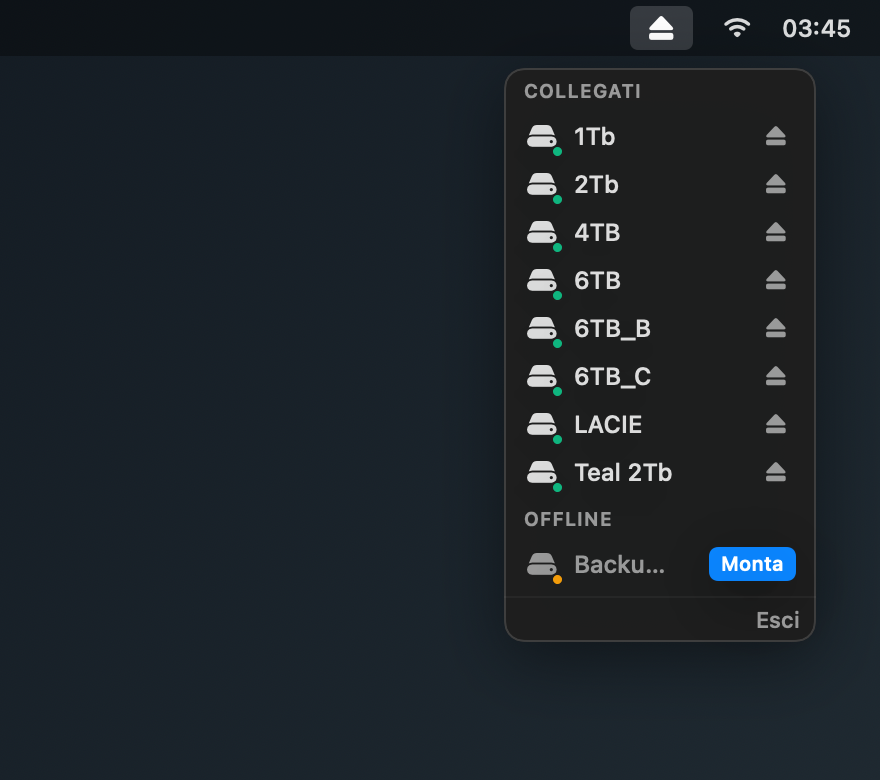

# Mount

[English](#english) · [Italiano](#italiano)



## English

Minimal native macOS menu bar utility to view and manage connected and offline external drives in one click. Inspired by Semulov and built from scratch in Swift & `DiskArbitration`.

### [Download DMG — macOS 14+](https://github.com/marcovernetto-lgtm/Mount/releases/download/v1.0.0/Mount-1.0.0.dmg)

Open the DMG and drag **Mount → Applications**.

- **Connected drives**: click a drive to open it in Finder, or click the eject icon to safely eject it.
- **Offline drives**: volumes that are still physically connected but unmounted appear under **Offline** with a one-click **Monta** button.
- **Zero clutter**: hides internal drives and system partitions (`EFI`, `Recovery`, `Preboot`, `VM`).
- **Real-time & lightweight**: uses `DiskArbitration` events (zero polling) and registers automatically at login.

---

## Italiano

Utility nativa e minimalista per la barra dei menu di macOS per vedere e gestire con un click i dischi esterni collegati e quelli offline. Ispirata a Semulov e ricostruita da zero in Swift con `DiskArbitration`.

### [Scarica DMG — macOS 14+](https://github.com/marcovernetto-lgtm/Mount/releases/download/v1.0.0/Mount-1.0.0.dmg)

Apri il DMG e trascina **Mount → Applicazioni**.

- **Dischi collegati**: clicca un disco per aprirlo nel Finder, oppure premi l'icona di espulsione per espellerlo in sicurezza.
- **Dischi offline**: i volumi ancora connessi fisicamente ma smontati compaiono in **Offline** con il pulsante **Monta**.
- **Zero rumore**: nasconde automaticamente dischi interni e partizioni di sistema (`EFI`, `Recovery`, `Preboot`, `VM`).
- **Leggera e in tempo reale**: basata su eventi `DiskArbitration` (zero polling) e con avvio automatico al login.

---

## Build from Source

```bash
swift test
./build.sh
```

Generates `build/Mount.app` and `build/Mount-1.0.0.dmg`.
